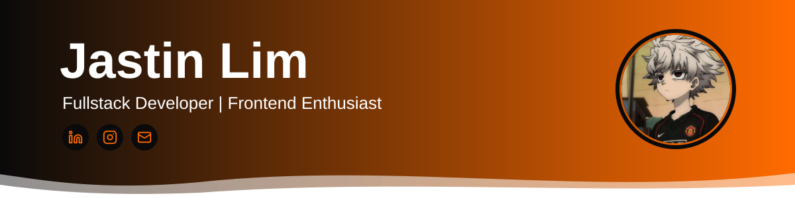

 

  

  

---

##  About Me

 Fullstack developer dengan ketertarikan besar di frontend dan UI/UX / Fullstack developer with a strong interest in frontend and UI/UX 
 Saat ini magang dan mengerjakan proyek website freelance / Currently interning and building freelance website projects 
 Open to work: magang, full-time, dan freelance / internship, full-time, and freelance 
 Fokus membuat antarmuka yang cepat, rapi, dan interaktif / Focused on building fast, clean, and interactive interfaces

---

##  Tech Stack

###  Frontend

  

###  Backend

  

###  Database

  

###  Tools and DevOps

  

---

##  Featured Projects

<table>
  <tr>
    <td width="33%" valign="top">
      <h3>Folks Institute</h3>
      
Website company profile modern dan responsif untuk Folks Institute.

      
 <a href="https://folks-company-profile.vercel.app/">Live Demo</a>

    </td>
    <td width="33%" valign="top">
      <h3>Cretivox Endurance Test</h3>
      
Technical test UI frontend dari Cretivox, fokus pada implementasi antarmuka yang rapi dan interaktif.

      
 <a href="https://cretivox-endurance-test-jastinlim.vercel.app/">Live Demo</a>

    </td>
    <td width="33%" valign="top">
      <h3>SuaraEkspor</h3>
      
Proyek lomba: platform web untuk mendukung dan menyuarakan ekspor.

      
 <a href="https://suara-ekspor.vercel.app/">Live Demo</a>

    </td>
  </tr>
</table>

Karya lainnya ada di [portofolio saya](https://jastin-lim-portfolio.vercel.app/).

---

##  GitHub Stats

 

 

---

##  Contribution Snake

  <picture>
    <source media="(prefers-color-scheme: dark)" srcset="https://raw.githubusercontent.com/JazeL2304/JazeL2304/output/github-snake-dark.svg" />
    <source media="(prefers-color-scheme: light)" srcset="https://raw.githubusercontent.com/JazeL2304/JazeL2304/output/github-snake.svg" />
    
  </picture>

---

##  Contact

 

